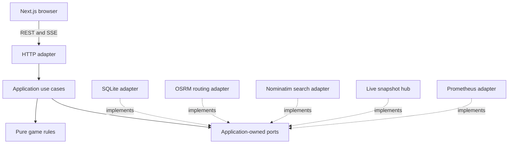
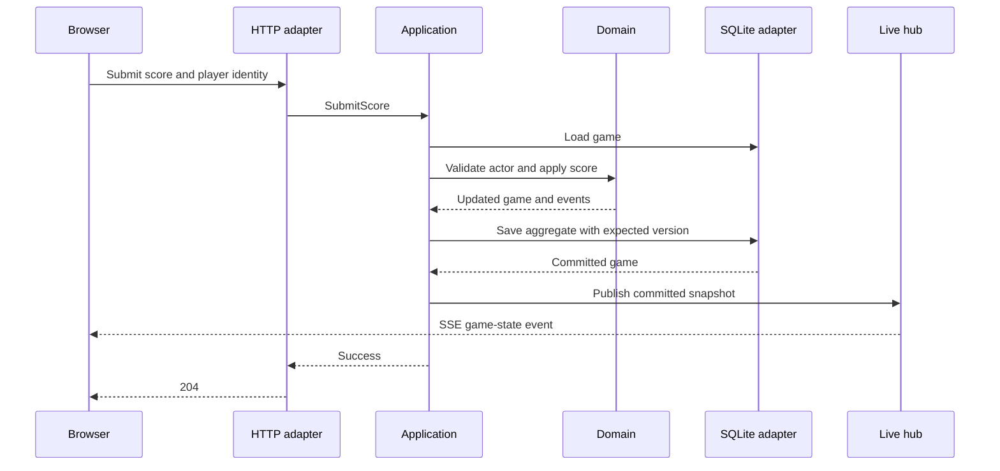
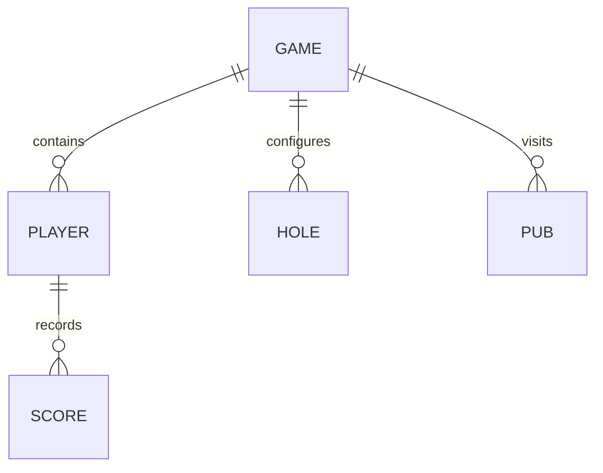

# Architecture

> System design, interfaces, and data flow for Pub Golf.

## Overview

Pub Golf runs one Go backend and a Next.js web application. The backend exposes REST and
server-sent events (SSE). SQLite stores games. Ports and adapters keep game rules independent
of transport, persistence, and external providers.

## Diagram

## Components

| Module | Responsibility | Location |
|--------|----------------|----------|
| Domain | Pure transitions, validation, permissions, typed failures | `apps/backend/internal/domain` |
| Application | Use cases, retry policy, ports, commit and subscription ordering | `apps/backend/internal/application` |
| Adapters | HTTP/SSE, SQLite, upstream calls, metrics, fake storage | `apps/backend/internal/adapters` |
| Executable | Configuration, dependency wiring, graceful shutdown | `apps/backend/cmd/pubgolf` |
| Frontend | Screens, REST client, EventSource hook | `apps/frontend` |
| Browser tests | Full game flows on desktop and mobile Chromium | `e2e` |

## Request Flow

Routing runs before the short write transaction. The use case then loads the current game,
revalidates permission, and saves with a version check. A routing failure saves pubs with no geometry.

## Key Decisions

- **Ports belong to their consumer.** Application packages define storage, routing, search,
  effect, and subscription interfaces. Adapters implement them. The executable wires them.
- **Pure rules.** Domain functions receive time and outcomes and return state plus events.
  They do not read clocks, generate random values, encode JSON, or access the database.
- **Game consistency.** SQLite saves all game-owned rows in one transaction. Expected versions
  reject stale writes. The application retries conflicts three times. Game-code creation tries five times.
- **Commit ordering.** One process-wide application mutex orders local mutations, committed
  notifications, and initial stream snapshots. External HTTP calls run outside this mutex.
  This suits one small process. Multiple backend processes require a different notification design.
- **Ephemeral notifications.** Events are dispatched in process after commit. Delivery errors
  are logged and do not undo committed actions. There is no outbox or replay store.
- **Full-state SSE.** Each connection receives a current snapshot before queued updates.
  Snapshots include the existing REST representation. Slow subscribers disconnect when their
  queue fills. Reconnection sends a new snapshot. Heartbeats run every 15 seconds.
- **REST compatibility.** The HTTP tests replay 32 exchanges captured from Kotlin at commit
  `5533f17`. The OpenAPI contract corrects the old generated spec's nullable fields and scalar
  score representation. It uses OpenAPI 3.0.3 for validator compatibility.
- **Identity compatibility.** Game reads and streams remain public. Player IDs identify mutation
  actors. Rejoin remains claim-by-name. This rewrite does not introduce account authentication.

## Data Model

The game row holds status, host identity, version, active event, and route geometry.
Player rows preserve join order and randomise state. Score rows hold timestamps and penalties.
Course rows preserve drink route order. SQL and JSON representations belong to the SQLite adapter.

Migrations are embedded and recorded in `schema_migrations`. The Go service uses a fresh database;
it does not migrate or open the previous Kotlin database.

## External Dependencies

| Dependency | Purpose | Failure behavior |
|------------|---------|------------------|
| OSRM | Walking route geometry | Save pubs without geometry |
| Nominatim | Place search | Return 503; serialize calls with a one-second interval and bounded waits |
| Reverse proxy | TLS and streaming | Must flush SSE and allow long connections; see cutover checks |
| Swagger UI CDN | Developer contract explorer | OpenAPI JSON remains available without the UI assets |
