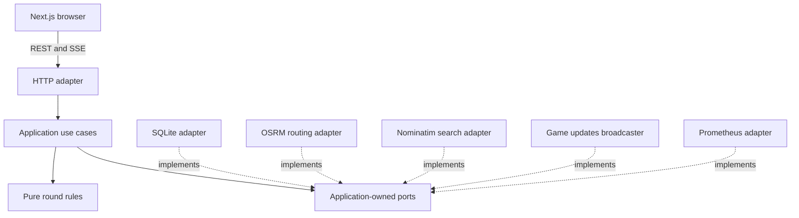
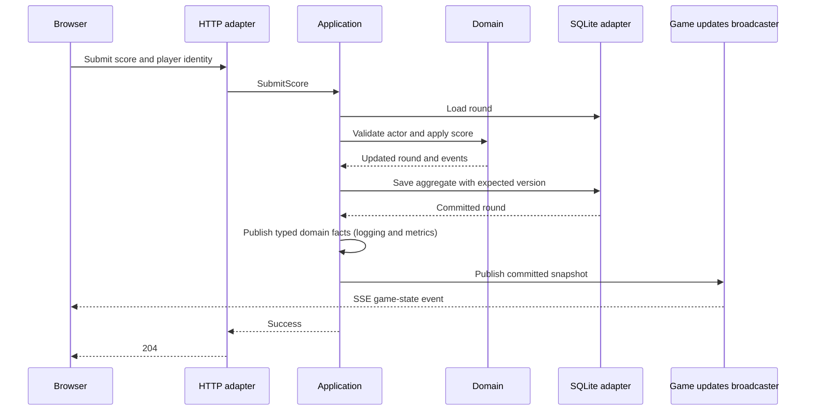
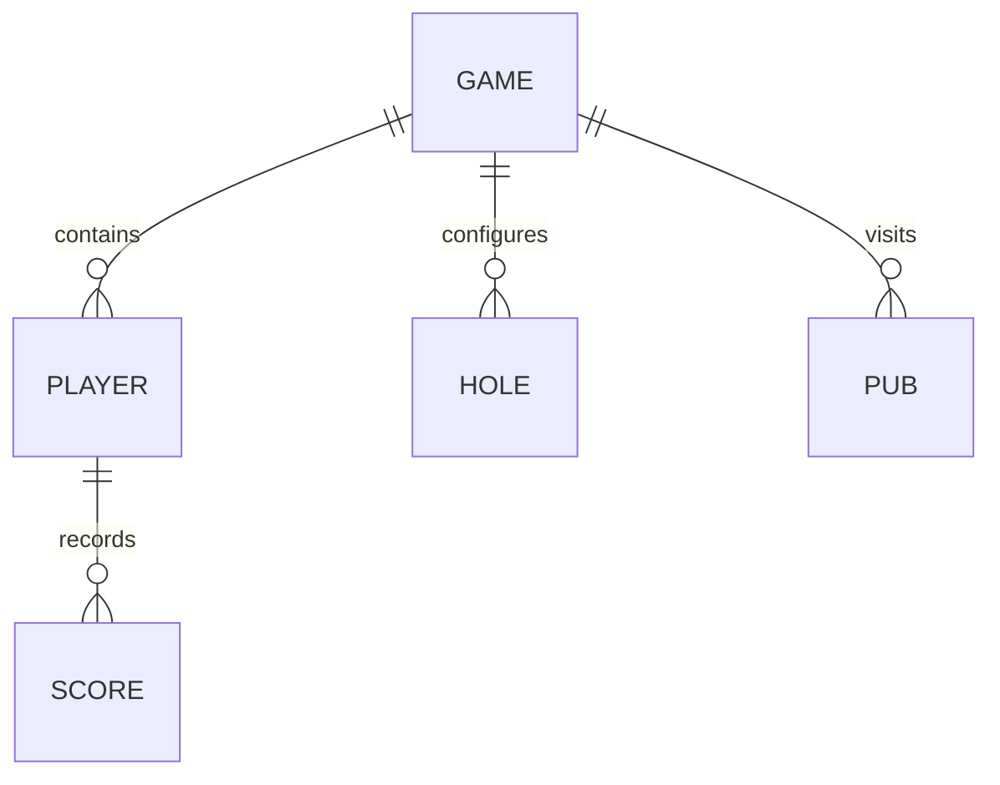

# Architecture

> System design, interfaces, and data flow for Pub Golf.

## Overview

Pub Golf runs one Go backend and a Next.js web application. The backend exposes REST and
server-sent events (SSE). SQLite stores games. Ports and adapters keep game rules independent
of transport, persistence, and external providers.

## Diagram

## Components

| Module | Responsibility | Location |
|--------|----------------|----------|
| Domain | Protected Round aggregate, validated values, typed domain facts and failures | `apps/backend/internal/domain` |
| Application | RoundCommands, RoundQueries, RoundSubscriptions, PlaceSearch, consumer-owned ports | `apps/backend/internal/application` |
| Adapters | HTTP/SSE, SQLite, upstream calls, metrics, fake storage | `apps/backend/internal/adapters` |
| Bootstrap | Configuration, adapter wiring, server lifecycle | `apps/backend/internal/bootstrap` |
| Executable | Signals and exit status | `apps/backend/cmd/pubgolf` |
| Frontend | Screens, REST client, EventSource hook | `apps/frontend` |
| Browser tests | Full game flows on desktop and mobile Chromium | `e2e` |

Concrete adapters are `sqlite.RoundRepository`, `gameupdates.Broadcaster`,
`osrm.PubRouteCalculator`, and `nominatim.PlaceSearcher`. Tests use `fakes.RoundRepository`
and separate fake domain-event and snapshot publishers. `bootstrap` constructs one private
commit coordinator shared by commands and subscriptions through `NewRoundApplication`.

## Request Flow

Routing runs before the short write transaction. The use case then loads the current round,
revalidates permission, and saves with a version check. A routing failure saves pubs with no geometry.

## Key Decisions

- **Ports belong to their consumer.** Application packages define storage, routing, search,
  publication, and subscription interfaces. Adapters implement them. Bootstrap wires them.
  `RoundRepository`, `PubRouteCalculator`, and `PlaceSearcher` describe concrete capabilities.
  `DomainEventPublisher` carries facts; `RoundStatePublisher` and `RoundStateSubscriber` carry browser snapshots.
- **Library reuse.** `go-sse` handles event framing and flushing; the gameupdates adapter keeps bounded
  per-browser queues. `sqlx` maps SQL rows, Goose runs migrations, `google/uuid` handles UUIDs,
  and `errgroup` coordinates server goroutines. Go rate and semaphore packages schedule place searches.
  These libraries stay in adapters or bootstrap.
- **Complexity limits.** Pinned golangci-lint v2.15.0 runs locally and in CI. Functions have
  cyclomatic complexity at most 10, at most 60 lines, and at most 40 statements, including tests.
- **Protected aggregate.** `Round` keeps state private. Its immutable methods validate rules and
  return a new round, distinct domain facts, and a typed failure. Validated values cover hole numbers,
  scores, pars, names, and pub locations. Zero remains a valid played score. Readers receive defensive
  snapshots; persistence reconstructs rounds through `RestoreRound`.
- **Pure rules.** Aggregate methods receive time and outcomes. They do not read clocks, generate
  random values, encode JSON, or access the database. Commands generate identifiers, timestamps,
  and random outcomes before retries and reuse them when rules run again.
- **Domain language.** One Round bounded context owns players, scores, the course, gameplay events,
  and the pub route. A DrinkTrack groups drink choices across holes. A PubRoute contains ordered pubs
  and optional walking geometry. GameplayEvent definitions and active state describe round modifiers;
  DomainEvent facts such as `ScoreSubmitted` describe completed changes. See [GLOSSARY.md](GLOSSARY.md).
- **Round consistency.** SQLite saves all game-owned rows in one transaction. Expected versions
  reject stale writes. The application retries conflicts three times. Game-code creation tries five times.
- **Commit ordering.** One process-wide application mutex orders local mutations, committed
  notifications, and subscription registration with its initial snapshot. External HTTP calls run outside this mutex.
  This suits one small process. Multiple backend processes require a different notification design.
- **Independent publication.** Domain facts and browser snapshots use separate ports after commit.
  The coordinator attempts both even if one fails. Delivery errors are logged and do not undo
  committed actions. There is no outbox or replay store.
- **Full-state SSE.** Each connection receives a current snapshot before queued updates.
  Snapshots include the existing REST representation. Slow subscribers disconnect when their
  queue fills. Reconnection sends a new snapshot. Heartbeats run every 15 seconds.
- **Code-first OpenAPI.** The HTTP adapter shares endpoint definitions between route registration
  and OpenAPI generation. `kin-openapi/openapi3gen` reflects the adapter request and response
  types. Required-field tags and the custom drinks codec schema describe the wire format.
  `make backend-openapi` regenerates the embedded document; CI rejects stale output.
  REST and SSE URLs remain unchanged. Operation identifiers and schema names now use Go names
  instead of the old Kotlin-generated names. Swagger UI still reads `/v3/api-docs`.
- **REST compatibility.** The HTTP tests replay 32 exchanges captured from Kotlin at commit
  `5533f17`. The OpenAPI contract corrects the old generated spec's nullable fields and scalar
  score representation. It uses OpenAPI 3.0.3 for validator compatibility.
- **Workflow reuse.** Pub Golf is public and `repo-templates` is private. GitHub does not allow
  this caller to use those private reusable workflows. Local copies of the canonical Go,
  OpenAPI, security, and container workflows keep CI runnable without changing repository access.
- **Identity compatibility.** Game reads and streams remain public. Player IDs identify mutation
  actors. Rejoin remains claim-by-name. This rewrite does not introduce account authentication.

## Data Model

The game row holds status, host identity, version, active event, and route geometry.
Player rows preserve join order and randomise state. Score rows hold timestamps and penalties.
Course rows preserve drink track order. SQL and JSON representations belong to the SQLite adapter.

Goose runs embedded migrations and records versions in `goose_db_version`. The Go service uses a fresh database;
it does not migrate or open the previous Kotlin database. The protected-domain refactor preserves
this Go schema and its stored JSON keys, including legacy `Route` drink keys. A frozen pre-refactor
SQL fixture verifies read and update compatibility. It requires no additional migration or deployment.

## External Dependencies

| Dependency | Purpose | Failure behavior |
|------------|---------|------------------|
| OSRM | Walking route geometry | Save pubs without geometry |
| Nominatim | Place search | Return 503; serialize calls with a one-second interval and bounded waits |
| Reverse proxy | TLS and streaming | Must flush SSE and allow long connections; see cutover checks |
| Swagger UI CDN | Developer contract explorer | OpenAPI JSON remains available without the UI assets |
